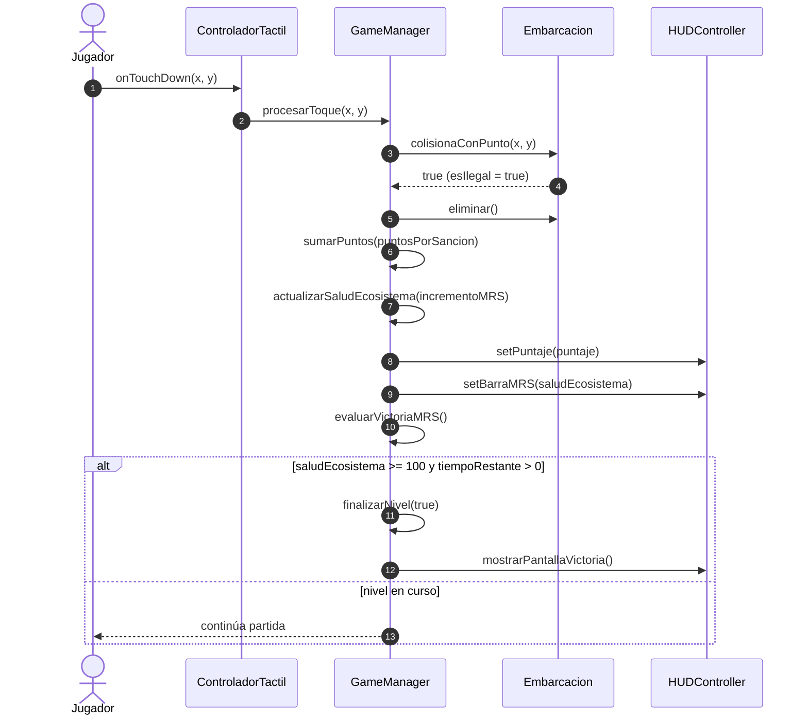

# Diagrama de Secuencia — EcoPatrulla-Marino

**Proyecto:** EcoPatrulla-Marino  
**Equipo:** Matheo Jaramillo Cardenas - Victor Manuel Magaña Perez  
**Versión:** 1.0  
**Fecha:** Noviembre 2026  

## Escenario principal
Flujo de sanción y eliminación de un barco ilegal (`RF-01`), actualización dinámica de la barra de salud del ecosistema (`RF-05`) y evaluación de la condición de victoria al alcanzar el 100% de Máximo Rendimiento Sostenible con tiempo restante (`RF-03`).

